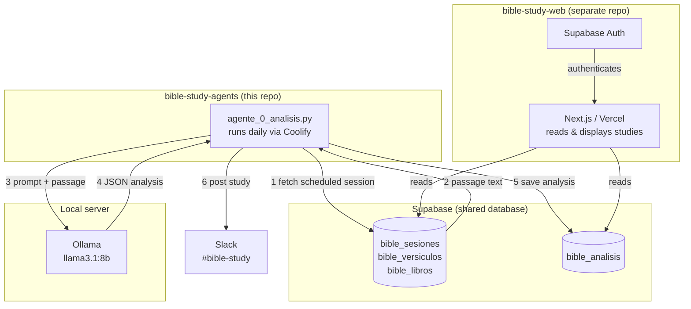

# Bible Study Agents

Automated daily Bible study pipeline. A Python agent retrieves a scheduled passage from Supabase, sends it to a local Llama 3.1 model via Ollama for theological analysis, persists the result back to Supabase, and delivers the study to a Slack channel. A companion Next.js web app (separate repo) lets users read past studies, highlight verses, and take notes.

> **Note on language:** The codebase — variable names, comments, database identifiers, Slack messages — is intentionally written in Spanish. The system was built for a Spanish-speaking audience and is maintained by a Spanish-speaking developer.

---

## Architecture



---

## Stack

| Component | Technology |
|---|---|
| Language | Python 3.11 |
| AI model | Llama 3.1 8B — local via Ollama |
| Database | Supabase (PostgreSQL) |
| Notifications | Slack API |
| Deployment | Docker on Coolify — daily scheduled task |
| Web frontend | Next.js on Vercel (separate repo: `bible-study-web`) |

---

## Repository structure

```
bible-study-agents/
├── agents/
│   └── agente_0_analisis.py      # Daily analysis agent
├── database/
│   ├── 001_crear_tablas_base.sql  # bible_libros, bible_capitulos, bible_versiculos
│   ├── 002_crear_tablas_plan.sql  # bible_usuarios, bible_planes, bible_sesiones
│   ├── 003_crear_tablas_estudio.sql
│   ├── ...                        # sequential migrations up to 012
├── scripts/
│   ├── descargar_y_cargar_versiones.py  # Load RVR1960, NVI, TLA from source
│   ├── cargar_plan.py                   # Seed a reading plan (338 sessions)
│   ├── poblar_templates.py              # Seed 7 study plan templates
│   ├── extraer_matthew_henry.py         # PDF → JSON commentary parser
│   ├── cargar_comentarios.py            # Load Matthew Henry commentary
│   └── setup_scheduler.ps1              # Legacy: Windows Task Scheduler setup
├── utils/
│   └── errores.py                 # Error types and Slack notifications
├── .env.example
├── .dockerignore
├── Dockerfile
└── requirements.txt
```

---

## Data model

The central chain is: **plan → sessions → verses → analysis**.

```
bible_libros (66 books × 4 versions)
    └── bible_capitulos (~4,756 chapters)
            └── bible_versiculos (~119,000 verses)
                        ▲
bible_usuarios
    └── bible_planes (version-specific reading plan)
            └── bible_sesiones (one row = one study day)
                    versiculo_inicio_id ──┘
                    versiculo_fin_id   ──┘
                        │
                        └── bible_analisis (LLM output stored here)
```

### Supporting tables

| Table | Purpose |
|---|---|
| `bible_secciones` | Passage titles per version (RVR1960, NVI, TLA) |
| `bible_configuracion` | Runtime config: available versions, default model |
| `bible_planes_templates` | 7 abstract study plans (no verse IDs) |
| `bible_planes_templates_fases` | Phases within each template |
| `bible_planes_templates_sesiones` | Abstract sessions (book + chapter range) |
| `bible_resaltados` | Per-user verse highlights |
| `bible_comentarios` | Matthew Henry commentary — 3,203 entries, all 66 books |
| `bible_notas` | Per-user personal notes per verse |

`bible_comentarios` and `bible_notas` have no FK to `bible_libros` — they reference by `abreviatura_libro + capitulo + versiculo` so they apply across all Bible versions without duplication.

Template sessions use `abreviatura_libro + capitulo_inicio + capitulo_fin` without verse IDs. Resolution to real verse IDs happens in `bible-study-web` when the user adopts a template and chooses a Bible version.

### Bible versions loaded

| Key | Version | Sections |
|---|---|---|
| `RVR1960` | Reina-Valera 1960 | Yes — primary version |
| `NVI` | Nueva Versión Internacional | Yes |
| `TLA` | Traducción al Lenguaje Actual | Yes |
| `RV1909` | Reina-Valera 1909 | No — comparative studies only |

---

## How to run

### Prerequisites

- Python 3.11+
- [Ollama](https://ollama.com) running locally with `llama3.1:8b` pulled
- A Supabase project with migrations applied (see `database/`)
- A Slack app with `chat:write` scope

### Setup

```bash
git clone <repo>
cd bible-study-agents
pip install -r requirements.txt
cp .env.example .env
# fill in .env with your credentials
```

### Running the agent manually

```bash
python agents/agente_0_analisis.py
```

The agent will:
1. Find today's scheduled session (or the oldest incomplete session from the past 3 days as fallback)
2. Fetch the passage verses from Supabase
3. Send it to Ollama for analysis
4. Save the JSON analysis to `bible_analisis`
5. Mark the session as completed
6. Post the study to Slack

### Seeding the database

```bash
# Load Bible text (RVR1960, NVI, TLA)
python scripts/descargar_y_cargar_versiones.py

# Create a reading plan (338 sessions, one user)
python scripts/cargar_plan.py

# Load 7 study plan templates
python scripts/poblar_templates.py

# Load Matthew Henry commentary (requires running extraer_matthew_henry.py first)
python scripts/cargar_comentarios.py
```

### Deployment

The agent runs as a Docker container on Coolify with a daily scheduled task. Coolify injects the environment variables — no `.env` file is needed in the image.

```bash
docker build -t bible-study-agents .
```

---

## Design decisions

**Llama is the analyst, never the source.** Bible text always comes from Supabase. The model never generates scripture — it only analyses passages it has been given verbatim.

**Version is pinned to the plan, not the user.** `bible_planes.version` determines which text the agent reads. This keeps the analysis reproducible and prevents drift if a user later changes their preferred version.

**3-day fallback for missed runs.** If no session is scheduled for today (weekend, network outage, deploy gap), the agent picks the oldest incomplete session from the past 3 days. This avoids silent skips without requiring a retry mechanism.

**Error handling is asymmetric.** Infrastructure failures (Ollama unreachable) abort the entire run and alert `#errores`. Per-session failures (malformed LLM output) are logged and skipped so other sessions in the same run still complete.

**Templates are abstract.** `bible_planes_templates_sesiones` stores `book + chapter range`, not verse IDs. Resolution to actual verse IDs happens in `bible-study-web` when the user adopts a template and picks a version, keeping the templates version-agnostic and reusable.

**Commentary and notes are version-agnostic.** `bible_comentarios` (Matthew Henry) and `bible_notas` reference verses by `abreviatura_libro + capitulo + numero_versiculo` rather than FK to `bible_versiculos`. A single commentary entry serves all four loaded versions.

---

## AI-assisted development

The system architecture, data model, and key design decisions in this document were designed by the author. [Claude](https://claude.ai/code) was used as an implementation tool: writing boilerplate, translating schema decisions into SQL migrations, debugging edge cases, and drafting documentation.

The division of responsibility matters for evaluating the project: the hard parts — what tables to create, how versions relate to plans, how to keep commentaries version-agnostic, the 3-day fallback rule — are human decisions. Claude accelerated their implementation.

---

## Known limitations / Next steps

**Verse range loads full chapters, not the exact range.**
`obtener_versiculos()` fetches all verses between `cap_inicio` and `cap_fin` without trimming by the starting and ending verse numbers within those chapters. A session defined as Gen 1:15–Gen 2:10 sends Gen 1:1–Gen 2:end to the model. The function also assumes the passage spans a single book — cross-book sessions are not handled.

**LLM output parsing relies on a regex fallback.**
The agent first tries `json.loads()` on the model response. If that fails (unescaped quotes, truncated output), it falls back to per-field `re.search()`. The correct fix is Ollama's structured output with a JSON schema, which eliminates the parsing step entirely.

**No validation of the generated analysis.**
The agent saves whatever the model returns after parsing — there is no check for empty fields, minimum length, or coherence. A session can be marked completed with an empty analysis if the model returns partial output that survives the regex fallback.

**Saving the analysis and marking the session complete is not atomic.**
`guardar_analisis()` and `marcar_completada()` are two separate Supabase calls. A crash between them leaves the session incomplete but with an analysis already saved. The next run inserts a duplicate analysis for the same session. A Postgres function wrapping both writes in a transaction would fix this.

**The timeout error message says 5 minutes but the real timeout is 30.**
`requests.post(..., timeout=1800)` — 1800 seconds = 30 minutes. The `RuntimeError` message on the next line says "timeout de 5 minutos". The message is wrong; the timeout is correct for a large local model.

**User identity is not yet unified with Supabase Auth.**
`bible_usuarios.id` is currently a standalone `gen_random_uuid()`, not tied to `auth.users.id`. Row-Level Security policies are the next hardening step — they require the two identities to be the same UUID so Supabase can enforce per-user data isolation automatically.
